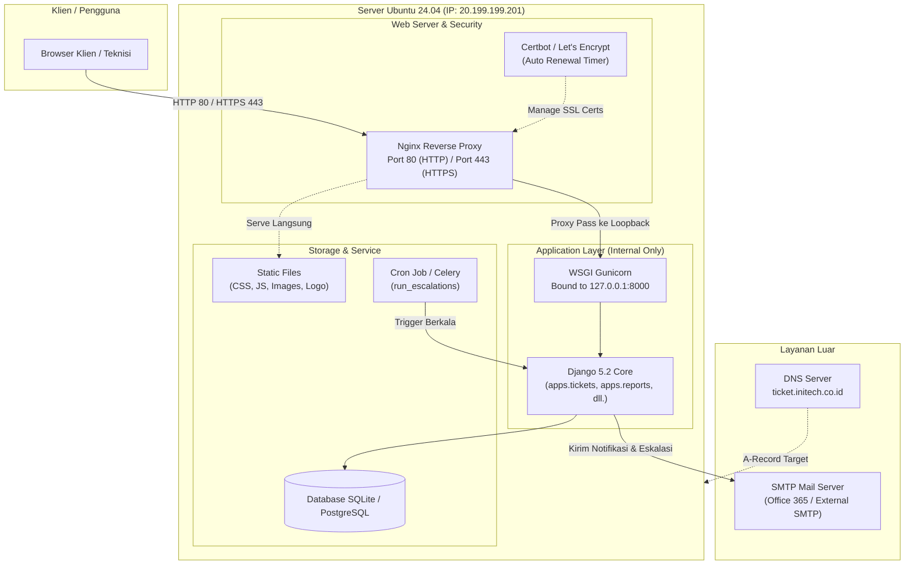
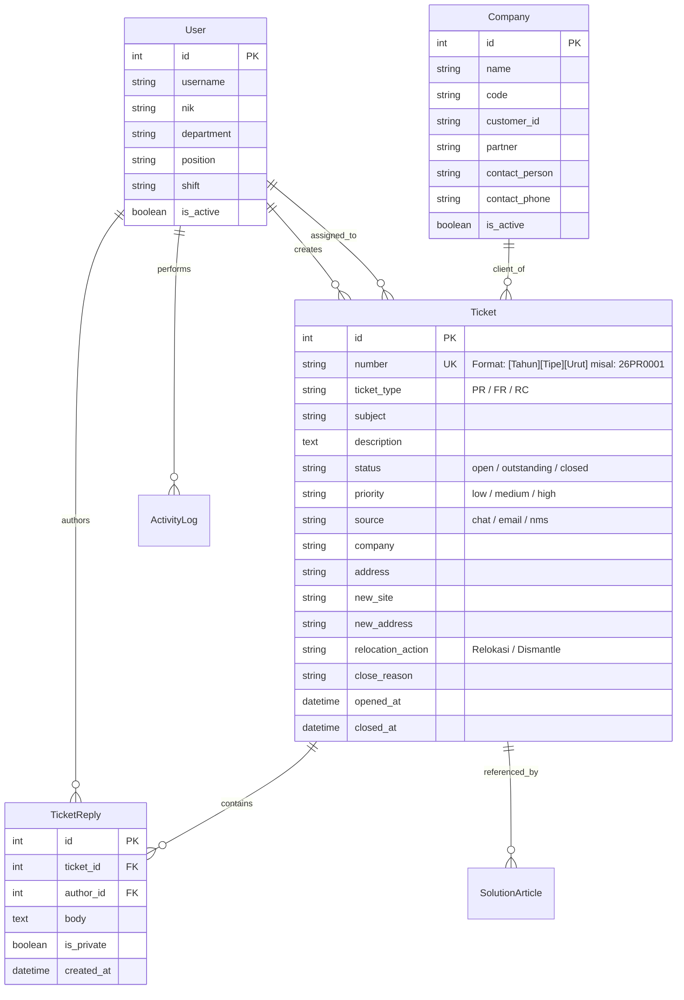

# DOKUMENTASI TEKNIS & ARSITEKTUR SISTEM
## Ticketing NMS — INITECH (Network Monitoring System)

---

## 1. Ringkasan Sistem (System Overview)

**Ticketing NMS** adalah sistem manajemen tiket operasional jaringan terpadu yang dirancang khusus untuk tim teknis dan manajemen **INITECH**. Sistem ini mencatat, melacak penanganan insiden jaringan (*Network Problem*), permintaan fitur (*Feature Request*), dan relokasi perangkat (*Relocation*), serta mengintegrasikan analitik laporan shift dan sistem eskalasi otomatis.

### Karakteristik Utama:
- **Framework Utama**: Django 5.2 (Python 3.15+) berbasis arsitektur monolit modular.
- **Database**: SQLite (Development) / PostgreSQL (Production via `DATABASE_URL`).
- **Frontend**: Django Templates render sisi server (SSR), Vanilla JavaScript, HTMX, dan Custom CSS Design System berbasis CSS Variables.
- **Reporting Engine**: OpenPyXL untuk otomatisasi ekspor laporan Excel standar operasional INITECH.
- **Notification & Escalation**: SMTP Email terintegrasi dengan penjadwalan eskalasi berjenjang.

---

## 2. Arsitektur Sistem & Infrastruktur Server

Sistem mengadopsi arsitektur **Three-Tier Monolith** dengan lapisan *Reverse Proxy* di bagian depan.

### 2.1. Diagram Topologi Server



### 2.2. Pembagian Peran Komponen

1. **Nginx (Front-facing Web Server)**:
   - Menerima koneksi dari luar pada port 80 (HTTP) dan port 443 (HTTPS).
   - Menyajikan file statis (`/static/`) langsung dari disk tanpa membebani Python.
   - Bertindak sebagai *buffer* dan penyaring koneksi sebelum diteruskan ke Gunicorn.
2. **Gunicorn (WSGI Application Server)**:
   - Terikat (*binding*) secara ketat pada `127.0.0.1:8000` (loopback internal).
   - **Tidak dapat diakses langsung dari internet**, sehingga aman dari eksploitasi langsung.
   - Menjalankan multi-worker proses Python untuk mengeksekusi kode Django.
3. **Django Application Core**:
   - Menangani routing, validasi form, bisnis logika tiket, manajemen sesi, dan otentikasi.
4. **Certbot (Let's Encrypt)**:
   - Menangani penerbitan dan pembaruan otomatis sertifikat TLS/SSL via Snap service timer (`snap.certbot.renew.timer`).

---

## 3. Struktur Direktori Proyek

Proyek diorganisasikan secara modular di dalam folder `apps/`:

```text
ticket-nms/
├── apps/
│   ├── accounts/          # Autentikasi kustom & profil teknisi/pengguna
│   │   ├── models.py      # Model User (NIK, Phone, Department, Shift)
│   │   └── views.py       # Login, Logout, Profile
│   ├── core/              # Komponen utilitas bersama
│   │   ├── models.py      # TimeStampedModel, ActivityLog, Notification
│   │   └── periods.py     # Logika kalkulasi rentang shift & waktu filter
│   ├── tickets/           # Jantung sistem ticketing
│   │   ├── admin.py       # Tampilan Django Admin & inline
│   │   ├── escalation.py  # Logika eskalasi email 3 fase
│   │   ├── forms.py       # TicketForm, CompanyForm, FilterForm
│   │   ├── models.py      # Model Company, Ticket, TicketReply
│   │   ├── views.py       # List, Create, Edit, Detail, API
│   │   └── urls.py        # Routing URL tiket & perusahaan
│   ├── reports/           # Modul ekspor analitik operasional
│   │   ├── excel.py       # Generator format Excel openpyxl
│   │   └── views.py       # Halaman analitik dan download Excel
│   └── solutions/         # Knowledge base & dokumentasi solusi gangguan
│       ├── models.py      # Model Article, Category
│       └── views.py       # Browse & buat artikel solusi dari tiket
├── config/                # Konfigurasi proyek Django
│   ├── settings/
│   │   ├── base.py        # Pengaturan dasar bersama
│   │   ├── dev.py         # Pengaturan lokal/pengembangan
│   │   └── prod.py        # Pengaturan produksi (Keamanan, Logging, SSL)
│   ├── asgi.py
│   ├── urls.py            # Master URL dispatcher
│   └── wsgi.py            # Entrypoint WSGI untuk Gunicorn
├── static/                # Aset statis (CSS Variables, JS HTMX, Gambar)
├── templates/             # Template HTML Django
│   ├── base.html          # Shell utama dan navigasi sidebar
│   ├── accounts/          # Template login & user
│   ├── tickets/           # Form tiket, detail, list, modal
│   ├── reports/           # Tampilan filter laporan
│   └── solutions/         # Knowledge base view
├── deploy/                # Skrip & konfigurasi deployment (Nginx, Systemd)
├── tests/                 # Unit test dan integration test
├── manage.py              # CLI Django
├── requirements.txt       # Dependensi produksi
└── requirements-dev.txt   # Dependensi tambahan dev (pytest, ruff, black)
```

---

## 4. Model Data & Skema Database

### 4.1. Entity Relationship (Konseptual)



### 4.2. Penjelasan Field & Logika Khusus Model

1. **Format Penomoran Tiket (`Ticket.number`)**:
   - Pola: `[2 Digit Tahun][Kode Tipe][4 Digit Nomor Urut]`
   - Contoh:
     - `26PR0001`: Problem tiket nomor 1 di tahun 2026.
     - `26FR0002`: Feature Request tiket nomor 2 di tahun 2026.
     - `26RC0003`: Relocation tiket nomor 3 di tahun 2026.
   - Digenerate secara aman oleh fungsi `Ticket.next_number(ticket_type)` menggunakan lock transaksi database untuk mencegah duplikasi nomor urut pada saat trafik bersamaan.

2. **Siklus Status Tiket**:
   - `open`: Tiket baru dibuat.
   - `outstanding`: Tiket yang sedang ditangani teknisi. Jika tiket berada pada status `open` selama lebih dari **60 menit**, fungsi `auto_escalate` akan otomatis mengubah statusnya menjadi `outstanding`.
   - `closed`: Tiket selesai ditangani. Wajib mencantumkan alasan penyelesaian (*Resolution category & Closing note*).
   - **Grace Period Edit**: Setelah tiket ditutup, staf non-admin hanya diberi waktu **10 menit** untuk merevisi catatan. Setelah itu, tiket terkunci (*locked*) dan hanya admin/superuser yang dapat mengubahnya.

---

## 5. Logika Bisnis Utama (Core Business Rules)

### 5.1. Aturan Validasi Tipe Tiket & Level Prioritas
- **Problem (PR)**:
  - Mengizinkan level: `Low`, `Medium`, `High`.
  - Jika kategori gangguan dipilih `Other`, field `problem_detail` **wajib diisi**.
- **Feature Request (FR)**:
  - Hanya mengizinkan level: `Medium` atau `High`. (Level `Low` dilarang).
- **Relocation (RC)**:
  - Hanya mengizinkan level: `Medium`.
  - Field `address` (alamat asal) **wajib diisi**.
  - Pilihan aksi: `Relokasi` (wajib isi *New Site* dan *New Address*) atau `Dismantle` (pelepasan perangkat).

### 5.2. Kriteria High Priority Otomatis
Sebuah tiket otomatis masuk dalam filter khusus **High Priority** jika:
1. Status tiket masih belum ditutup (`exclude(status='closed')`).
2. Tipe tiket **PR** atau **FR** yang umurnya sudah melebihi **5 hari**.
3. Tipe tiket **RC** yang umurnya sudah melebihi **60 hari (2 bulan)**.

### 5.3. Logika Filter Shift (Melintasi Tengah Malam)
Sistem memiliki 5 periode shift operasional INITECH.
Shift 5 berjalan dari jam **23:00 hingga 03:00**:
- Ketika teknisi membuka filter Shift 5 pada jam **03:00 pagi**, sistem (`apps/core/periods.py`) mendeteksi bahwa waktu saat ini berada di awal hari (< 23:00), sehingga otomatis mengambil tanggal mulai dari **kemarin jam 23:00** hingga **hari ini jam 03:00**.

### 5.4. Logika Eskalasi Email 3 Fase (`run_escalations`)
Perintah `python manage.py run_escalations` memantau umur tiket yang belum selesai:
1. **Fase 1 (Umur tiket $\ge$ 1 Hari)**: Notifikasi dikirimkan ke **Lead NSM** (`badtime141@gmail.com`).
2. **Fase 2 (Umur tiket $\ge$ 5 Hari)**: Notifikasi dikirimkan ke **Project Manager & Engineers** (`rozanarib@outlook.com`, `Aaziz@initech.co.id`).
3. **Fase 3 (Umur tiket $\ge$ 14 Hari / 2 Minggu)**: Notifikasi dikirimkan ke **Direktur** (`fajrianto@initech.co.id`).

Email dikirim menggunakan template HTML responsif dengan ringkasan status tiket, PIC, dan tombol tautan langsung ke detail tiket. Flag `--dry-run` tersedia untuk simulasi tanpa mengirim email fisik.

---

## 6. Standar Git & Branching Strategy

Dalam pengembangan proyek ini, diberlakukan aturan percabangan yang ketat:

| Branch | Fungsi | Aturan Akses |
|---|---|---|
| **`dev`** | Cabang utama pengembangan & pengujian | Seluruh fitur baru, perbaikan bug, dan pengujian harus di-commit dan di-push ke sini terlebih dahulu. |
| **`main`** | Cabang rilis produksi (Live) | **Dilarang keras melakukan commit atau push langsung ke `main`**. Merge ke `main` hanya dilakukan setelah fitur diuji di `dev` dan mendapat persetujuan rilis. |

---

## 7. Panduan Operasional & Cheatsheet Perintah

### 7.1. Menjalankan di Lingkungan Lokal (Development)
```bash
# Aktifkan virtual environment
source venv/bin/activate

# Jalankan server lokal
python manage.py runserver 127.0.0.1:8000

# Jalankan pemeriksaan sistem
python manage.py check

# Jalankan pengujian unit test
python manage.py test apps.tickets
```

### 7.2. Operasional Produksi di Server Ubuntu
```bash
# Cek status web server Nginx
sudo systemctl status nginx

# Restart Nginx setelah ubah konfigurasi
sudo nginx -t && sudo systemctl reload nginx

# Cek status service Gunicorn
sudo systemctl status gunicorn

# Restart service Gunicorn setelah update kode baru
sudo systemctl restart gunicorn

# Jalankan migrasi database di produksi
python manage.py migrate --settings=config.settings.prod

# Kumpulkan file statis
python manage.py collectstatic --noinput --settings=config.settings.prod

# Cek simulasi eskalasi email tiket
python manage.py run_escalations --dry-run
```

### 7.3. Konfigurasi Otomatisasi Crontab
Untuk menjalankan eskalasi otomatis setiap jam di server produksi:
```cron
0 * * * * cd /home/ubuntu/ticket-nms && /home/ubuntu/ticket-nms/venv/bin/python manage.py run_escalations >> /home/ubuntu/ticket-nms/logs/escalation.log 2>&1
```

---

## 8. Panduan Integrasi SSL & Domain Produksi

1. **Buat A-Record di DNS Manager**:
   - Host: `ticket` (atau `ticket.initech.co.id`)
   - Target IP: `20.199.199.201`
2. **Penerbitan Sertifikat via Certbot (Setelah DNS Aktif)**:
   ```bash
   sudo certbot --nginx -d ticket.initech.co.id
   ```
3. **Ubah variabel di `.env` produksi setelah HTTPS aktif**:
   ```ini
   DJANGO_SECURE_SSL_REDIRECT=True
   DJANGO_CSRF_COOKIE_SECURE=True
   DJANGO_SESSION_COOKIE_SECURE=True
   SITE_BASE_URL=https://ticket.initech.co.id
   ```
4. **Reload aplikasi**:
   ```bash
   sudo systemctl restart gunicorn && sudo systemctl reload nginx
   ```
